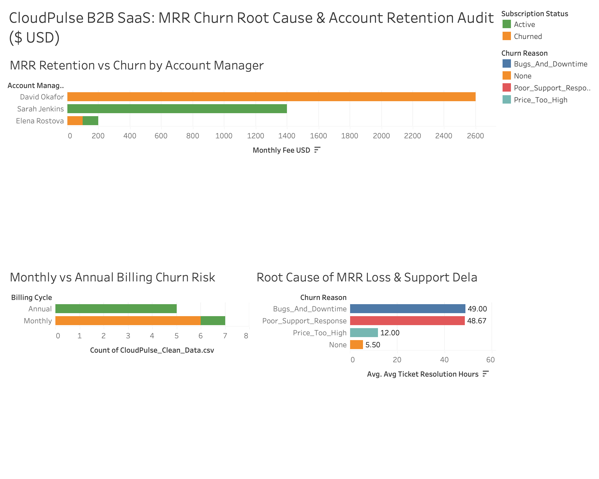

# ☁️ CloudPulse B2B SaaS: MRR Churn Root Cause & Account Retention Audit ($ USD)
**Tools Used:** MySQL (`CASE WHEN` MRR Segmentation, `INNER JOIN`, Churn Rate % Math, `ROUND()`) | Tableau (Executive SaaS Retention Dashboard)

## 📌 Executive Summary
CloudPulse is a B2B Software-as-a-Service (SaaS) platform offering **Basic ($50/mo)**, **Pro ($200/mo)**, and **Enterprise ($800/mo)** subscription tiers. Facing a sudden drop in **Monthly Recurring Revenue (MRR)**, leadership needed to identify whether churn was driven by pricing, product bugs, customer support delays, or billing structure.

I conducted a full SQL and Tableau retention audit across `Subscription_Logs` and `Customer_Accounts` to quantify lost MRR, compare **Monthly vs. Annual** contract retention, and audit Account Manager SLA performance.

---

## 📊 Executive SaaS Churn & MRR Dashboard (Tableau)

---

## 🔍 Key SaaS Metrics & Root Cause Findings (via MySQL)

### 1. Monthly vs. Annual Contract Churn Showdown
- **Annual Billing Cycle:** Achieved a **0.00% Churn Rate** (5 out of 5 accounts remained Active, preserving **$1,450/mo** in locked-in MRR).
- **Monthly Billing Cycle:** Suffered an **85.71% Logo Churn Rate** (6 out of 7 monthly accounts cancelled), resulting in **$2,700/month ($32,400 ARR)** in lost recurring revenue.

### 2. Support Ticket SLA Bottleneck (The 48-Hour Churn Trigger)
- **Active Accounts (`None`):** Averaged only **1.5 support tickets** with a fast average resolution time of **5.5 hours**.
- **Churned Accounts (`Poor_Support_Response` & `Bugs_And_Downtime`):** Opened an average of **9.3 to 9.5 support tickets** and waited **48.7 to 49.0 hours (2+ days)** for resolution—directly triggering the cancellation of three **$800/mo Enterprise** accounts and one **$200/mo Pro** account (**$2,650/mo lost MRR**).

### 3. Account Manager Retention Audit (`JOIN` Analysis)
- **David Okafor:** Suffered a **100% client churn rate (4 of 4 accounts churned)**, losing **$2,600/mo in MRR** (96.3% of all company revenue loss), driven by an average support resolution delay of **52.0 hours**.
- **Sarah Jenkins:** Maintained a **0% churn rate (4 of 4 accounts retained)** with an average support resolution speed of **5.8 hours**.
- **Elena Rostova:** Lost only **$100/mo** across two small startup accounts (**14.5 hours** average resolution speed).

---

## 💡 Strategic SaaS Retention Recommendations
1. **Eliminate Monthly Billing for Enterprise Tiers:** Require Annual (or minimum Quarterly) contracts for all **$800/mo Enterprise** onboarding, as Annual contracts demonstrated **0% churn**.
2. **Enforce a <12-Hour Priority SLA for Enterprise Support:** Automatically escalate any Enterprise/Pro support ticket unresolved after **8 hours**, preventing the 48-hour delay threshold that triggered 96% of MRR churn.
3. **Reassign High-Value Enterprise Accounts:** Immediately audit David Okafor's support workflow and transition onboarding Enterprise accounts to Sarah Jenkins' SLA playbook (<6-hour response benchmark).
